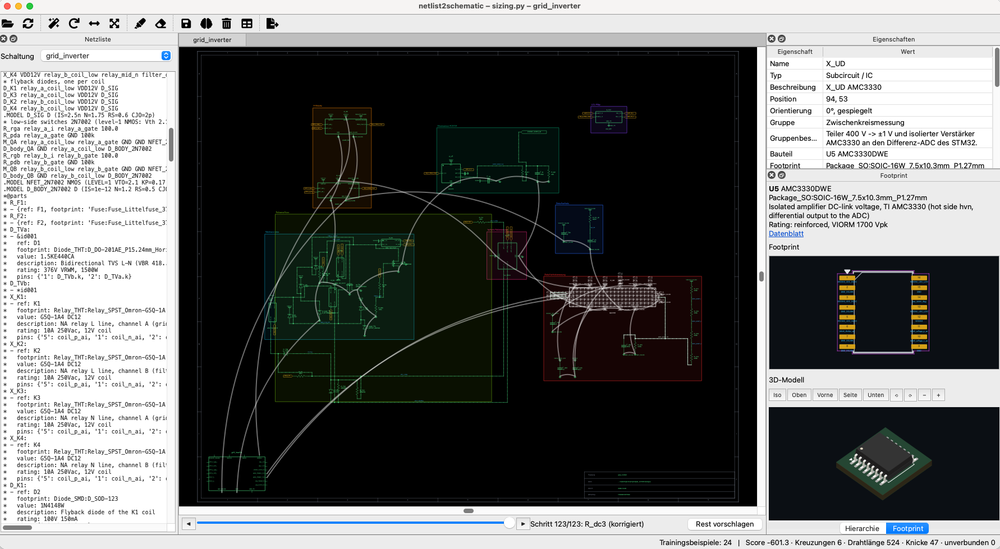

# Netlist2Schematic

[](LICENSE)


**Readable schematics from SPICE / Xyce netlists.** Netlist2Schematic turns a netlist into a
schematic drawing that a human can actually read: standard symbols, signal flow from left to
right, supplies on top, grounds at the bottom, functional blocks kept together. Part placement
is proposed by a small neural policy (written in [MLX](https://github.com/ml-explore/mlx)) that
learns *your* drawing style from the corrections you make in the editor; wires are drawn by a
grid autorouter.



*The editor with a 400 V grid inverter: netlist dock (left), the sheet with coloured functional
groups, fly lines of the selected part's nets and the circuit's own block symbol (bottom left),
properties and footprint / 3D dock (right).*

## Why

Netlists are the golden source of a circuit when it is generated or sized by code, but nobody
reviews a netlist by reading it. Netlist2Schematic produces a schematic for every subcircuit,
for review in an editor and as SVG for reports, without anyone drawing it by hand. When the
proposal is not good enough, you correct it once; the correction is stored as training data
and the next proposal gets better.

## Features

- **Parser** for rendered Xyce netlists: subcircuits, ports, elements, `.MODEL` types,
  coupled inductors (`K`), continuation lines and braced expressions.
- **Standard symbols**: R, C, L, diodes, independent and controlled sources, BJT, MOSFET,
  switches, transformers (multi-winding, centre tap), full bridge rectifiers (detected from four
  diodes), IC boxes and plain blocks for subcircuits of the design.
- **Pins grouped by function** from the port naming convention: inputs left, outputs right,
  supplies on top, grounds at the bottom; active-low pins get an inversion bubble.
- **Supply and ground symbols** directly at every pin on a rail; nets between ICs only are
  connected by name (labels), everything else by wires.
- **Functional groups** from a YAML header in the netlist: coarse floorplan first (one region
  per group, ordered by signal flow), then the detail placement inside the regions.
- **Learned placement**: a GNN over the netlist graph plus a relation scorer that compares
  every candidate position with the already placed neighbours; action masking guarantees that
  every proposal is valid (no overlaps, free pin exits).
- **Editor** (PySide6): unbounded sheet, zoom at the cursor, multi-select, rotate / mirror,
  history slider that replays every decision of the policy with its probability map, tabs for
  subcircuits (double click a block), hierarchy, properties, KiCad footprint and 3D dock.
- **Fly lines** like Virtuoso's flight lines: curved, semi-transparent lines between all
  places a selected net appears, so connections by name are found even off-screen.
- **Sheet frame** with grid references (A, B, … / 1, 2, …), title block and the circuit's own
  block symbol; clicking one of its pins selects that port's net.
- **SVG export** of the same drawing, for HTML reports.

## How it works

```
netlist ──► parser ──► diagram (symbols, nets, groups)
                          │
                          ├─► coarse floorplan: one region per functional group
                          │
                          └─► placement policy (MLX): one part at a time, breadth-first
                                from the first IC; may revise earlier parts
                                          │
                                          ▼
                              grid autorouter ──► Qt editor / SVG
                                          ▲
        manual corrections ──► training database ──► behaviour cloning + DAgger
```

- **Placement order**: the first IC (else transformer, else source), then breadth-first over
  the wired nets: all children of the current part in pin order, then their children. After
  every new part the policy may move up to three connected, already placed parts (revisions).
- **Policy**: GNN embeddings of all parts give a context (current part, placed parts,
  unplaced parts); a shared MLP scores every candidate (anchor cell × 8 orientations) from
  translation-invariant features; a relation scorer encodes the exact offset to each placed
  neighbour (Fourier features), which is what captures a drawing style; a learnable prior
  encodes conventions (grounds down, supplies up, inputs left, ...).
- **Training**: behaviour cloning on approved drawings (newest drawing per netlist),
  augmented with connected sub-circuits and shifted copies, soft targets for neighbouring
  cells, displaced revisions (to learn corrections) and DAgger rounds with a relative oracle.
- **Routing**: orthogonal grid router with perpendicular crossings only; pins are left and
  entered straight.

## Installation

Requirements:

- Python **3.15+** and [uv](https://docs.astral.sh/uv/) (or pip)
- [MLX](https://github.com/ml-explore/mlx) — runs best on Apple silicon (macOS); see the MLX
  documentation for Linux support
- optional: [KiCad](https://www.kicad.org/) (footprint library and `kicad-cli`) for the
  footprint and 3D dock

```bash
git clone https://github.com/SeimSoft/Netlist2Schematic.git
cd Netlist2Schematic
uv sync --extra dev
```

## Quick start

```bash
uv run n2s ui path/to/circuit.cir          # open the editor (.cir, sizing.py or .jinja2)
uv run n2s suggest path/to/circuit.cir     # print a placement proposal
uv run n2s train                           # retrain on the training database
uv run n2s stats                           # database and model status
```

A fresh installation has no trained weights: the first proposals use the built-in prior of
conventions only. Correct a drawing in the editor, press **Send training data**, then
**Neu trainieren** (retrain) — see [Training your drawing style](#training-your-drawing-style).

From Python:

```python
from netlist2schematic.api import svg_for

svg = svg_for("path/to/circuit.cir")              # top subcircuit
svg = svg_for("path/to/circuit.cir", "my_subckt")  # a given subcircuit
```

### Input files

- **`.cir` / `.sp` / `.net`**: a rendered netlist; every subcircuit can be shown.
- **`sizing.py`**: a module with a `sizing()` function that returns the rendered netlist. In a
  project laid out as `src/project/<circuit>/sizing.py`, the module is imported as part of that
  package, and `bom.yaml` next to it provides package pin numbers and child circuits.
- **`netlist.cir.jinja2`**: rendered through the `sizing.py` next to it.

Approved drawings are stored next to the source as `schematic.json` (when the source lives in a
circuit folder with a `bom.yaml`) and loaded instead of a new proposal.

## Netlist conventions

Netlist2Schematic draws any netlist, but it draws much better ones that follow a few
conventions.

### Port and net names

| Name | Meaning | Drawn as |
| --- | --- | --- |
| `pwm_a_high_i`, `sense_ai` | input (digital / analog) | pin on the left, label left of its wire |
| `fault_o`, `grid_voltage_ao` | output (digital / analog) | pin on the right, label right of its wire |
| `reset_ni`, `ready_no` | active-low input / output | with an inversion bubble |
| `bus_io`, `line_aio` | bidirectional | either side |
| `VDD3V3`, `VDD12V`, `VDD470V_DCLINK` | supply rail (upper case) | supply symbol at every pin, pins on top |
| `GND`, `GND_DCLINK`, `VSS5V_ISO` | ground (contains `GND`, starts with `VSS` / `VEE`) | ground symbol at every pin, pins at the bottom |

Grounds other than `0` / `GND` show their name at the symbol, so isolated grounds stay
distinguishable.

### Functional groups

Right after a `.subckt` line, a YAML header in comment lines describes the circuit and its
functional blocks. Members are element names, `fnmatch` patterns or `port:<net>`:

```spice
.subckt iso_sense grid_l_ai grid_n_ao VDD3V3 GND grid_voltage_ao grid_current_ao
*@groups
* description: Isolated measurement of grid voltage and current.
* groups:
* - id: voltage
*   title: Voltage measurement
*   members: ['R_d[1-5]', C_d, X_U1, 'C_u*']
*   description: High-impedance divider and isolated amplifier.
* - id: current
*   title: Current measurement
*   members: [R_sh, R_f1, R_f2, C_f, X_U2, 'C_i*']
*   color: "#d97706"
*@end
...
.ends
```

Parts not listed form an implicit "rest" group; each group is placed as one block and drawn as
a coloured region with its title (click it for the description).

### Footprints

An optional `*@parts` header per subcircuit maps instances to board parts (KiCad footprint,
value, description, datasheet, pad → terminal). The footprint dock then shows the selected
symbol's footprint with the net on every pad, and a 3D render via `kicad-cli`.

## Training your drawing style

1. Open a netlist; the policy builds a proposal step by step on screen (`Esc` stops it).
2. Move, rotate (`R`) and mirror (`M`) parts until the drawing reads well. A correction in the
   middle of the history discards the later steps; `▶` / `N` asks the policy for one more step,
   **Rest vorschlagen** completes the drawing.
3. **Send training data** stores the drawing in the training database.
4. **Neu trainieren** retrains the policy (minutes, on the GPU with MLX).

**Trainingsdaten…** lists all examples with the number of derived training variants; open an
example to step through it with the current model's probability map, or delete it.

`experiments/01_synthetic_training/` contains a small set of hand-drawn textbook circuits
(filters, transistor stages, H-bridge, LDO) and the tooling to add them as training data and
compare proposals before and after training.

## Editor reference

| Input | Action |
| --- | --- |
| mouse wheel, pinch, Ctrl/Cmd + scroll | zoom at the cursor |
| trackpad scroll, right / middle drag, Space + drag | pan |
| drag on empty space | rubber band selection |
| `R` / `M` | rotate / mirror the selection |
| `F` | fit the drawing |
| `N` / `B` | next / previous history step |
| `Esc` | stop building a proposal |
| click a wire or label | select the net (fly lines, properties) |
| `9` / `0` | highlight the selected nets in a random colour / clear all highlights |
| double click a block | open the subcircuit in a new tab |
| `Ctrl+S` | send training data |

The editor's user interface is currently in German.

## Configuration

| Variable | Default | Purpose |
| --- | --- | --- |
| `N2S_DATA` | `./data` | training database, model weights and render caches |
| `N2S_KICAD_FOOTPRINTS` | auto-detected | KiCad footprint library directory |
| `N2S_KICAD_CLI` | auto-detected | `kicad-cli` executable |
| `N2S_RESISTOR` | `ieee` | resistor symbol style (`ieee` zigzag or `iec` box) |

## Project structure

| Module | Responsibility |
| --- | --- |
| `netlist.py` | netlist parser, naming convention, `*@groups` header |
| `symbols.py`, `diagram.py` | symbols, components, nets, groups, own block symbol |
| `groups.py` | coarse floorplan of the functional groups |
| `placement.py` | occupancy, overlap checks, repair of stored drawings |
| `env.py` | sequential placement environment with action masking and features |
| `policy.py` | MLX policy: GNN, candidate MLP, relation scorer, prior |
| `trainer.py`, `augment.py`, `training_db.py` | training (behaviour cloning, DAgger), proposals |
| `routing.py`, `metrics.py` | grid autorouter and drawing score |
| `render.py`, `graphics.py`, `frame.py` | drawing primitives, SVG, sheet frame, fly lines |
| `footprint.py` | KiCad footprint drawing and 3D renders |
| `ui.py`, `cli.py`, `api.py`, `sources.py` | editor, command line, Python API, input files |

## Development

```bash
uv sync --extra dev
uv run pytest
```

The UI tests run headless (`QT_QPA_PLATFORM=offscreen` is set in `tests/conftest.py`); tests that
need KiCad are skipped when it is not installed.

## Limitations

- Early stage: the policy needs a handful of drawings in your style before its proposals are
  useful, and training is not perfectly stable (new examples can disturb learned ones).
- Proposals are best with beam search; the step-by-step build in the editor is greedy.
- Score weights and the prior are hand-picked; changing the feature layout invalidates stored
  weights (they are re-initialised; retrain).
- Only the Xyce netlist dialect used by the authors is tested.

## Contributing

Issues and pull requests are welcome. Please add a test for every change in behaviour
(`uv run pytest` must pass) and keep the code style of the surrounding module.

## License

[MIT](LICENSE) © 2026 SeimSoft
